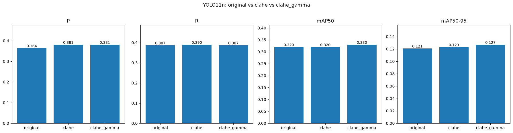

# XCA 영상의 관상동맥 협착 탐지: 전처리와 YOLO 성능 비교

관상동맥 X-ray Coronary Angiography(XCA) 영상에서 협착(stenosis)을 탐지하기 위해 **독립적으로 수행한 이미지 전처리·객체 탐지 실험**을 정리한 AI/ML 포트폴리오입니다. ARCADE 데이터 분석, 병변 ROI 중심 전처리 평가, YOLO11n 학습, Faster R-CNN 및 YOLO 모델 크기 비교를 다룹니다.

이 저장소의 수치는 제공된 노트북에 **이미 저장되어 있던 출력**에서 추출했습니다. 정리 과정에서 모델을 재학습하거나 의료 데이터로 재평가하지 않았습니다. 원본 데이터·체크포인트·원본 `results.csv`는 제공된 ZIP에 포함되어 있지 않습니다.

## 실험 질문과 접근

- 협착 주변의 대비와 혈관 윤곽을 강화하면 탐지 성능도 개선되는가?
- CLAHE 단독과 CLAHE+Gamma의 이미지 품질·검출 성능은 어떻게 다른가?
- 같은 전처리가 다른 탐지기에서도 유효한가? 모델 크기를 늘리면 개선되는가?

COCO annotation 분석 → 전처리 후보 7종 생성 → 이미지 전체/병변 ROI 품질 평가 → COCO-to-YOLO 라벨 변환 → YOLO11n 전처리 비교 → torchvision Faster R-CNN/YOLO11s 비교 순서로 진행했습니다. Segmentation 라벨 변환과 2단계 ROI crop cascade는 후속 구현이며, 실제 데이터에서의 성능 개선은 확인되지 않았습니다.

## 확인된 주요 결과

YOLO11n 전처리 비교의 **최종 `best.pt` 검증 로그**입니다. 각 실험은 100 epoch 완료 기록이 있고, validation 200장·협착 annotation 406개에 대해 평가했습니다. 숫자는 저장된 로그의 반올림 정밀도를 그대로 사용합니다.

| 입력 | Precision | Recall | mAP50 | mAP50-95 |
|---|---:|---:|---:|---:|
| Original | 0.364 | 0.387 | 0.320 | 0.121 |
| CLAHE | 0.381 | 0.390 | 0.320 | 0.123 |
| CLAHE + Gamma | 0.381 | 0.387 | 0.330 | 0.127 |

CLAHE+Gamma는 Original 대비 mAP50-95 **+0.006(0.6%p), 상대 +4.96%**였습니다. 이는 반올림된 validation 수치의 차이이며, 반복 실험·통계적 유의성·별도 test 성능은 확인 필요입니다. 이미지 품질 향상 폭을 탐지 성능 향상 폭으로 해석하지 않습니다.



출처: `04_train_yolo(cursor).ipynb.ipynb` cell 7. 위 그래프는 `05A` cell 6의 원본 PNG이며, cell 4에서 수동 입력한 수치가 앞선 검증 로그와 일치함을 확인했습니다. `05A` cell 3의 CSV 기반 최고 epoch 수치와는 구분합니다.

| 추가 실험 | 상태 | 기록된 결과·해석 |
|---|---|---|
| Faster R-CNN ResNet50-FPN, Original / CLAHE+Gamma | 30 epoch 학습 기록 확인 | VOC 방식 AP50 최대 0.295686 / 0.290947. 이 비교에서는 전처리 개선 효과가 나타나지 않음 |
| Faster R-CNN ResNet50-FPN-v2, CLAHE+Gamma | 30 epoch 학습 기록 확인 | AP50 최대 0.268508 |
| Faster R-CNN ResNet50-FPN, CLAHE+Gamma 단일 실행 | 100 epoch 기록 확인 | AP50 최대 0.310905. 이후 30 epoch 실행과 같은 폴더를 재사용하므로 별도 기록으로 취급 |
| Faster R-CNN MobileNetV3-FPN | 집계 결과만 확인 | AP50 0.185888, 최고 checkpoint epoch 5. 전체 학습 로그·총 epoch 확인 필요 |
| YOLO11n / YOLO11s, CLAHE+Gamma | 각 50 epoch 기록 확인 | 최종 mAP50-95 0.122 / 0.121. 이 조건에서 모델 크기 증가에 따른 개선은 확인되지 않음 |
| Swin / ConvNeXt / ViT 커스텀 backbone | 인터페이스 스켈레톤 | 실제 backbone 통합·협착 탐지 학습 완료 기록 없음. Swin 이름의 toy 회귀만 실행 기록 있음 |
| `03.6`, `06A`–`06C` | 실험 미완료/기록 없음 | segmentation 변환, ROI crop, cascade 구현. 실제 ARCADE 평가 수치 확인 필요 |
| `05D`, `05E` | 저장된 실행 오류 있음 | `NameError` 기록. `05E`에는 후속 표·그래프도 있어 전체 재실행 성공 여부는 확인 필요 |

Faster R-CNN은 직접 구현한 **VOC 11-point AP50(score ≥ 0.05)**를 사용합니다. Ultralytics mAP50과 평가 방식이 달라 단일 종합 순위로 우열을 확정하지 않습니다. 상세 근거는 [실험 요약](docs/experiment_summary.md)과 [수치 출처·주의점](results/README.md)에 있습니다.

## 데이터셋

- 코드에서 확인되는 데이터셋: **ARCADE stenosis**, COCO JSON의 `category_id=26` → YOLO class `0`(torchvision은 background `0`, stenosis `1`).
- 저장된 기록: train **1,000장 / annotation 1,625개**, validation **200장 / 406개**. train의 협착 라벨이 없는 이미지는 3장, validation은 0장.
- train bbox 면적 평균 **4,836.93 px²**, 중앙값 **2,782.64 px²**. 평균 너비 63.7 px, 높이 66.9 px. 다수의 작은 병변을 다루는 문제로 접근했습니다.
- 초기 탐색의 총 이미지 3,000장은 ZIP 데이터 전체 검색 결과이며, 이번 stenosis 학습 표본 수와 동일하지 않습니다.
- 데이터 버전, 공식 다운로드 주소, 라이선스·재배포 조건, 환자별 분할 여부, test 평가: **확인 필요**.

의료영상 원본·병변 crop·전처리 미리보기는 재배포 권한이 확인되지 않아 공개 파일에 포함하지 않았습니다. 본 저장소에는 집계 그래프만 수록합니다. 데이터는 적법한 사용 권한을 확인해 별도로 준비해야 합니다.

## 전처리와 평가 지표

`02_preprocessing.ipynb`에서 CLAHE, Gamma, Frangi, CLAHE+Gamma, CLAHE+Gamma+Frangi, Gamma+CLAHE+Frangi, Black-hat을 생성합니다. Unsharp와 Top-hat은 탐색 함수/시각화이며 위 7종 배치 실험과 구분합니다.

최종 선택 셀에는 CLAHE `clipLimit=2.0`, `tileGrid=(4,4)`, Gamma `0.8`, Frangi `sigmas=1..4`, `gamma=15`, `black_ridges=True`, Black-hat kernel `15`가 기록되어 있습니다. 함수 기본값과 튜닝 셀 값은 다를 수 있으므로 순서대로 실행하고 최종 선택 셀을 확인해야 합니다.

`03_quality_metrics.ipynb`는 train 이미지의 entropy, 표준편차 대비, Canny edge density(50/150), Laplacian variance, Brenner focus를 전체 이미지와 GT bbox ROI에서 계산합니다. ROI는 이미지 안 병변별 평균을 먼저 구한 뒤 이미지별 평균을 냅니다. GT가 없는 이미지는 ROI 지표 0으로 포함합니다.

| 전처리 | ROI contrast | ROI edge density | global Laplacian variance |
|---|---:|---:|---:|
| Original | 17.958918 | 0.074510 | 230.966124 |
| CLAHE | 34.135542 | 0.240672 | 548.082601 |
| CLAHE+Gamma | 32.315488 | 0.224897 | 521.803766 |

출처: `03_quality_metrics` cell 7의 저장된 평균 표. 대비·경계 증가에는 노이즈 증폭도 포함될 수 있으며, 임상적 영상 품질이나 탐지 성공을 직접 보장하지 않습니다. 다른 전처리의 지표도 [추출 CSV](results/tables/03_quality_metrics__cell_007_output_03.csv)에 보존했습니다.

## 저장소 구성

```text
notebooks/                 # 원본 11개: 셀 순서·이름 유지, 공개용 출력 정리
scripts/                   # 원본 06A/06B/06C + 결과 보존 검증 도구
results/
  figures/                 # 원본 출력에서 추출한 집계 그래프 5개
  tables/                  # 저장된 표의 HTML/CSV, FRCNN epoch history, YOLO 최종 검증
  evidence/                # 경로를 익명화한 지표·완료·오류 로그
  image_manifest.json      # 22개 이미지의 출처·SHA-256·공개 여부
docs/
  experiment_summary.md    # 실험별 목적·방법·결과·해석
  reproducibility.md       # 환경 근거, 실행 순서, 미해결 사항
  publication_review.md    # 공개 위험 및 보존 정책
  change_report.md         # 변경 파일·재현성 영향·검증 내역
  source_manifest.json     # ZIP·14개 원본 파일과 정리본 해시
```

원본 ZIP·전체 원본 출력·의료영상은 저장소 밖에 보존했습니다. 동일 해시의 중복 파일은 없었으며, 노트북의 반복 코드와 출력 출처는 가능한 한 유지했습니다.

## 실행 방법

**아래는 재실행 절차이며, 의료 데이터로 실행 검증한 환경은 아닙니다.** 기존 출력 열람에는 데이터가 필요하지 않습니다. 원본 로그의 Python은 3.12.6이며 패키지 전체 lockfile은 없습니다. 정확히 확인되지 않은 버전은 지정하지 않았습니다. [환경 확인 문서](docs/reproducibility.md)를 먼저 읽어 주세요.

```bash
python -m venv .venv
source .venv/bin/activate
python -m pip install -r requirements.txt
python scripts/verify_portfolio.py
cd notebooks
jupyter lab
```

PyTorch/torchvision은 사용할 CPU 또는 CUDA 환경에 맞는 공식 배포 조합을 먼저 확인하세요. 원본 로그에 남은 버전의 현재 설치 가능 여부는 확인 필요입니다. 설치 성공만으로 과거 실험 재현을 의미하지 않습니다.

적법하게 확보한 데이터는 `data/arcade/arcade/stenosis/{train,val}/images/`와 `annotations/{train,val}.json`에 준비합니다. 원본 학습 가중치는 별도 확보가 필요합니다. 노트북의 작업 디렉터리는 `notebooks/`입니다.

1. `01_dataset` → `02_preprocessing` → `03_quality_metrics`로 데이터와 전처리를 확인합니다. `01`의 `--force-reinstall opencv-python` 셀은 환경을 바꿀 수 있으므로 필요 여부를 확인합니다.
2. `03.5_Data Preparation`에서 images/labels를 준비하고 **모든 학습 대상의 train/val 개수 일치**를 확인합니다. `04`에 CLAHE/CLAHE+Gamma의 val 이미지 동기화와 검증 셀이 있습니다.
3. `04_train_yolo(cursor).ipynb.ipynb`의 GPU `DEVICE=0`, batch, workers를 장비에 맞게 검토한 뒤 명시적으로 학습 셀을 실행합니다. `05A`의 `use_manual=True`는 **과거 결과**를 덮어쓰므로 새 실험 집계 시 `False`로 바꾸어야 합니다.
4. Faster R-CNN 비교는 `05B`에서 수행합니다. `RUN_MATRIX=True`, `RUN_YOLO_SCALES=True`로 설정되어 있어 전체 실행 시 추가 학습이 시작됩니다. 새 실행에는 별도 run 이름을 사용해 과거 기록 덮어쓰기를 피하세요.
5. `05D`, `05E`는 [기록된 오류와 경로/평가 차이](docs/reproducibility.md)를 먼저 검토합니다. `03.6`, `06A`–`06C`는 미완료 확장 작업입니다.

Segmentation 변환 스크립트는 `python scripts/06A_convert_coco_to_yolo_seg.py --help`로 옵션을 확인하고 `--data-dir`를 지정합니다. `--dry-run`도 빈 디렉터리를 생성할 수 있습니다. `06B`에는 CLI가 있고, `06C`는 두 모델과 crop helper 함수를 인자로 받는 import용 모듈입니다. Detection/segmentation 라벨을 같은 디렉터리에 섞지 않습니다.

## 트러블슈팅과 한계

- 전처리 validation 이미지 0장 문제: `03.5`의 CHECK 출력 뒤 `04` 동기화에서 200장 복사 및 준비 완료 기록이 있습니다.
- `05D`의 `random`, `05E`의 `load_frcnn_rows` NameError: 선행 정의 셀 실행 순서를 확인해야 합니다. 정리 과정에서 결과 오류를 숨기거나 코드 수정을 통해 성공으로 바꾸지 않았습니다.
- `05B`의 MMCV wheel 부재는 원본 markdown의 환경 설명입니다. 실제 구현은 torchvision이며 Swin/ConvNeXt MMDetection 학습이 아닙니다.
- `05D`는 `02_clahe_gamma`를 참조하지만 실제 배치 경로는 `04_clahe_gamma`입니다. 이 불일치는 결과 재현에 영향을 주므로 별도 수정 대상으로 기록했습니다.
- `05A`는 최고 mAP50-95 epoch, `05E`는 최고 mAP50 epoch, 최종 YOLO 로그는 best checkpoint 재검증입니다. 선택 규칙이 다르므로 같은 수치로 합치지 않습니다.
- test 평가, 환자 단위 분할·누출 검사, 다중 seed, 신뢰구간, 외부 검증, 추론 지연시간은 확인 필요입니다. 의료 진단용 검증이나 임상적 효용을 입증한 프로젝트가 아닙니다.
- ROI crop/cascade는 GT 기반 학습 crop과 예측 기반 추론 crop 사이 분포 차이, stage 1에서 놓친 병변 복구 한계가 있습니다. 성능 검증 기록은 없습니다.

코드·모델·데이터의 라이선스 및 재배포 조건은 별도 확인이 필요하며, 확인되지 않은 원본 이미지와 가중치를 함께 배포하지 않습니다.
