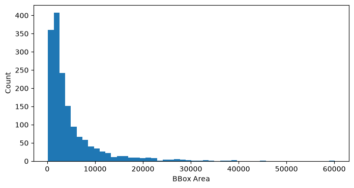
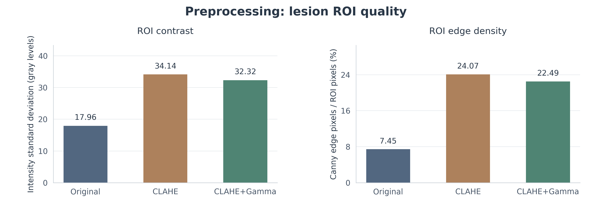
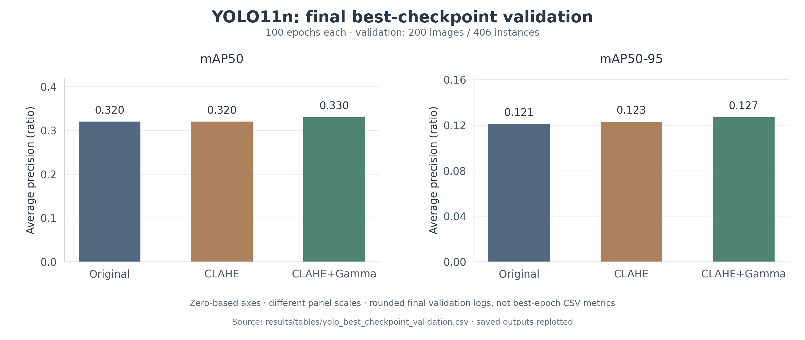
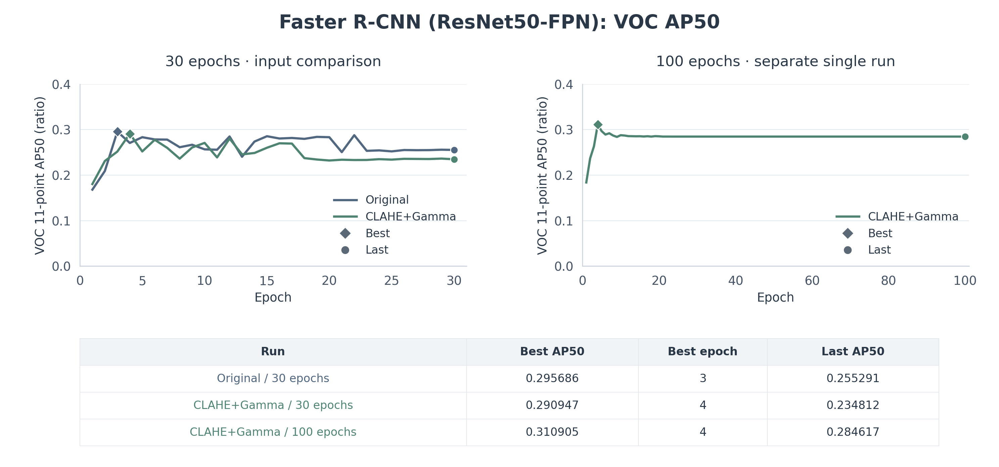

# 실험 결과 및 시각화

ARCADE 데이터셋을 활용한 관상동맥 협착 탐지 실험의 성능 지표와 시각화 자료를 정리했습니다.

YOLO11n의 전처리별 성능 비교와 Faster R-CNN의 학습 이력을 중심으로, 그래프에 사용한 수치와 평가 조건을 함께 기록했습니다.

실험에 사용한 원본 이미지와 학습 가중치는 이 저장소에 포함하지 않았습니다. 결과 CSV는 Jupyter Notebook에 저장된 표와 학습 로그를 바탕으로 정리한 자료이며, 원본 `results.csv`나 `history.csv` 자체는 아닙니다.

## 1. 주요 결과 그래프

프로젝트 [README](../README.md)에 사용한 그래프는 다음과 같습니다.

| 구분 | 시각화 | 내용 |
|---|---|---|
| 데이터 분석 | [협착 bbox 면적 분포](figures/01_dataset__cell_023_output_01.png) | 학습 데이터의 협착 영역 크기 분포 |
| 전처리 비교 | [ROI 품질 비교](figures/preprocessing_roi_quality.png) | Original, CLAHE, CLAHE+Gamma의 영상 품질 지표 |
| YOLO 학습 결과 | [YOLO11n 검증 성능](figures/yolo11n_final_validation.png) | 전처리별 mAP50 및 mAP50-95 |
| Faster R-CNN | [AP50 학습 이력](figures/frcnn_ap50_history.png) | ResNet50-FPN의 30 epoch 비교와 별도 100 epoch 실험 |

### 1.1 협착 Bounding Box 면적 분포



학습 데이터의 협착 영역 크기를 확인하기 위한 히스토그램입니다.

병변의 크기 분포를 살펴보고, 작은 협착 영역의 탐지를 개선하기 위해 영상 전처리와 ROI 기반 방법을 탐색했습니다.

이 그래프는 전체 병변의 크기 분포를 보여주며, 작은 병변만을 대상으로 한 탐지 성능을 의미하지는 않습니다.

### 1.2 전처리별 ROI 품질 비교



Original, CLAHE, CLAHE+Gamma의 병변 ROI에서 대비와 경계 밀도를 비교했습니다.

그래프에 사용한 수치는 [품질 지표 CSV](tables/03_quality_metrics__cell_007_output_03.csv)를 기준으로 합니다.

| 전처리 | ROI Contrast | ROI Edge Density |
|---|---:|---:|
| Original | 17.958918 | 0.074510 |
| CLAHE | 34.135542 | 0.240672 |
| CLAHE+Gamma | 32.315488 | 0.224897 |

ROI Contrast는 픽셀 밝기의 표준편차이며, Edge Density는 Canny Edge로 검출된 픽셀의 비율입니다.

그래프에서는 Edge Density를 백분율(%)로 표시했습니다. 예를 들어 Original의 0.074510은 약 7.45%에 해당합니다.

CLAHE에서 두 지표가 높게 나타났지만, 이것만으로 실제 협착 탐지 성능이 가장 좋다고 판단하지 않았습니다.

### 1.3 YOLO11n 전처리별 성능 비교



Original, CLAHE, CLAHE+Gamma를 사용해 YOLO11n을 각각 100 epoch 학습했습니다.

검증 데이터는 이미지 200장, 협착 annotation 406개이며, 각 실험의 `best.pt` 최종 검증 결과는 다음과 같습니다.

| 입력 데이터 | Precision | Recall | mAP50 | mAP50-95 |
|---|---:|---:|---:|---:|
| Original | 0.364 | 0.387 | 0.320 | 0.121 |
| CLAHE | 0.381 | 0.390 | 0.320 | 0.123 |
| CLAHE+Gamma | 0.381 | 0.387 | **0.330** | **0.127** |

이 그래프에는 [최종 검증 결과 CSV](tables/yolo_best_checkpoint_validation.csv)의 세 가지 YOLO11n 100 epoch 실험 수치를 사용했습니다.

CLAHE+Gamma의 mAP50-95는 Original보다 0.006 높았습니다.

영상 대비를 높이는 것이 탐지 정확도를 동일한 폭으로 개선하는 것은 아니었으며, 이번 조건에서의 개선 폭은 제한적이었습니다.

### 1.4 Faster R-CNN 학습 이력



ResNet50-FPN에서 Original과 CLAHE+Gamma를 비교한 30 epoch 실험과, CLAHE+Gamma로 진행한 별도의 100 epoch 실험을 구분했습니다.

| 모델 및 입력 | Epoch | 최고 AP50 | 최고 Epoch | 마지막 AP50 |
|---|---:|---:|---:|---:|
| ResNet50-FPN / Original | 30 | 0.295686 | 3 | 0.255291 |
| ResNet50-FPN / CLAHE+Gamma | 30 | 0.290947 | 4 | 0.234812 |
| ResNet50-FPN / CLAHE+Gamma | 100 | 0.310905 | 4 | 0.284617 |

30 epoch 비교에서는 Original 입력이 CLAHE+Gamma보다 높은 AP50를 보였습니다.

100 epoch 실험의 최대 AP50는 0.310905였지만, 30 epoch 실험과는 별도 실행이므로 하나의 동일한 실험으로 합치지 않았습니다.

최고 AP50가 초반 epoch에서 나타났다는 사실만으로 과적합 원인을 단정할 수는 없습니다.

## 2. 평가 지표와 수치 선택 기준

### 영상 품질 평가

**ROI Contrast**

8-bit 영상의 픽셀 밝기 표준편차를 사용했습니다.

**ROI Edge Density**

Canny Edge 검출 결과에서 경계 픽셀이 차지하는 비율을 계산했습니다.

Canny Threshold는 50과 150이며, 그래프에서는 계산된 비율에 100을 곱해 %로 표시했습니다.

영상 품질 지표의 증가가 곧 객체 탐지 성능의 개선을 의미하는 것은 아닙니다.

### YOLO 평가

YOLO의 mAP50 및 mAP50-95는 Ultralytics 평가 결과를 사용했습니다.

대표 그래프에는 각 모델의 최종 `best.pt` 검증 결과를 적용했습니다.

다만 실험 과정에서 사용한 결과 선택 기준은 다음과 같이 구분됩니다.

| 구분 | 선택 기준 | CLAHE+Gamma 결과 |
|---|---|---|
| `04` 최종 검증 | `best.pt` 최종 검증 | mAP50 0.330 / mAP50-95 0.127 |
| `05A` 집계 | 최고 mAP50-95 epoch | mAP50-95 0.12703 |
| `05E` 집계 | 최고 mAP50 epoch | mAP50 0.345780 / 해당 epoch의 mAP50-95 0.12645 |

`05A`는 mAP50-95가 가장 높은 epoch를 선택한 결과이고, `05E`는 mAP50가 가장 높은 epoch를 선택한 결과입니다.

따라서 같은 CLAHE+Gamma 실험에서 나온 값이라도 기준이 다른 수치를 섞지 않았습니다.

### Faster R-CNN 평가

Faster R-CNN에는 직접 구현한 VOC 11-point AP50를 사용했습니다.

- IoU Threshold: 0.50
- Score Threshold: 0.05
- AP 계산: VOC 11-point 방식

YOLO의 Ultralytics mAP50와 Faster R-CNN의 VOC AP50는 평가 방식이 서로 다르므로 수치를 직접 비교해 모델 순위를 결정하지 않았습니다.

## 3. Faster R-CNN 결과 데이터

학습 이력 그래프에 사용한 CSV는 다음과 같습니다.

| 실험 | 데이터 파일 | 최대 AP50 |
|---|---|---:|
| Original / 30 epoch | [History CSV](tables/05B_cell_008__frcnn_resnet50_fpn__original_history.csv) | 0.295686 |
| CLAHE+Gamma / 30 epoch | [History CSV](tables/05B_cell_008__frcnn_resnet50_fpn__clahe_gamma_history.csv) | 0.290947 |
| CLAHE+Gamma / 100 epoch | [History CSV](tables/05B_cell_007__single_resnet50_fpn__clahe_gamma_history.csv) | 0.310905 |

그래프에는 epoch별 AP50를 보간하거나 평활화하지 않고 사용했습니다.

범례의 `Best`는 최고 AP50를 기록한 epoch, `Last`는 마지막 epoch를 의미합니다.

최대값과 최종값은 [요약 CSV](tables/frcnn_history_summary.csv)에서도 확인할 수 있습니다.

## 4. 그래프 재생성 방법

대표 성능 그래프는 CSV 데이터를 기반으로 작성했습니다.

새 환경에서도 같은 입력 데이터를 사용해 그래프를 생성할 수 있도록 Python 스크립트를 제공합니다.

**실행 스크립트:** `scripts/plot_experiment_results.py`

저장소 루트에서 다음 명령을 실행합니다.

```bash
python scripts/plot_experiment_results.py
```

별도의 출력 디렉터리를 지정하려면 다음과 같이 실행할 수 있습니다.

```bash
python scripts/plot_experiment_results.py --output-dir /tmp/xca-plots
```

스크립트는 Python 표준 라이브러리의 CSV 처리 기능과 Matplotlib을 사용합니다.

기본적으로 다음 파일을 생성합니다.

- `preprocessing_roi_quality.png`
- `yolo11n_final_validation.png`
- `frcnn_ap50_history.png`
- `visualization_manifest.json`

그래프는 기본 240 DPI로 저장하며, CSV에 기록된 수치를 기반으로 막대와 학습 곡선을 그립니다.

파일별 생성 정보와 입력 CSV는 [시각화 Manifest](figures/visualization_manifest.json)에서 확인할 수 있습니다.

이 과정은 저장된 실험 결과를 다시 시각화하는 작업이며, 모델을 새로 학습하거나 의료영상에 대해 추론하는 과정은 아닙니다.

## 5. 결과 데이터 구성

`results/` 폴더에는 주요 그래프, 실험별 결과표, 로그에서 정리한 CSV가 포함되어 있습니다.

### Figures

실험 결과를 시각적으로 확인하기 위한 PNG 파일입니다.

원본 노트북의 집계 그래프와 CSV를 바탕으로 작성한 대표 그래프가 포함되어 있습니다.

개별 의료영상이나 환자별 전처리 예시는 포함하지 않았습니다.

### Tables

실험별 성능 수치와 학습 이력을 정리한 CSV 파일입니다.

주요 파일은 다음과 같습니다.

| 파일 | 내용 |
|---|---|
| `yolo_best_checkpoint_validation.csv` | YOLO 모델별 최종 `best.pt` 검증 결과 |
| `03_quality_metrics__cell_007_output_03.csv` | 전처리별 영상 품질 지표 |
| `frcnn_history_summary.csv` | Faster R-CNN 실행별 최대 AP50 및 학습 이력 요약 |
| `05A_*` | YOLO 최고 mAP50-95 기준의 집계 결과 |
| `05B_*` | Faster R-CNN 및 YOLO의 모델별 실험 결과 |
| `05E_*` | 모델별 성능 비교 및 추가 집계 결과 |

일부 CSV는 저장된 Jupyter Notebook 출력에서 정리한 자료로, 원래 학습 과정에서 생성한 전체 `results.csv` 또는 `history.csv`와 동일하지 않습니다.

원본에 없던 수치를 새로 만들어 넣거나, 서로 다른 실행 결과를 동일한 조건의 실험으로 합치지 않았습니다.

## 6. 결과 해석 시 주의사항

이번 실험에서 CLAHE+Gamma를 적용한 YOLO11n의 최종 mAP50-95는 Original보다 0.006 높았습니다.

하지만 전처리가 모든 모델에서 동일하게 성능을 개선한 것은 아닙니다.

Faster R-CNN의 30 epoch 비교에서는 Original 입력이 CLAHE+Gamma보다 높은 AP50를 보였고, YOLO11s는 50 epoch 조건에서 YOLO11n보다 mAP50-95가 낮았습니다.

또한 일부 학습 결과는 동일한 출력 폴더를 사용한 서로 다른 실행에서 생성됐습니다. 학습 조건과 결과 선택 기준을 함께 확인해야 합니다.

이 자료는 당시 실험의 성능과 경향을 비교하기 위한 것이며, 별도 외부 데이터셋을 이용한 임상적 유효성 검증 결과는 아닙니다.

---

### 관련 문서

- [프로젝트 README](../README.md)
- [실험일지](../docs/experiment_summary.md)
- [실행 환경과 재현성](../docs/reproducibility.md)
- [데이터 공개 범위 검토](../docs/publication_review.md)
